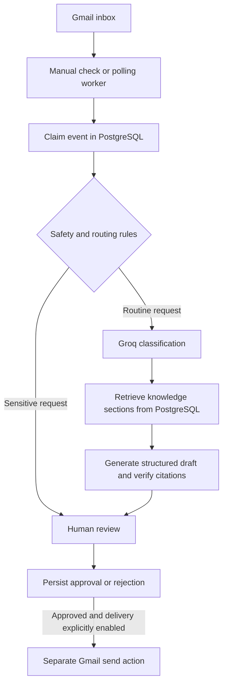

# Pingo AI Customer Support Agent

Pingo turns support email into a cited reply draft for a human reviewer. Its demo retailer, Gears and Co, sells chargers, power banks, and wireless earbuds. A plausible answer can still invent product behavior or promise a refund. Pingo retrieves company articles, validates model output, and records why each message became a draft or an escalation. Email delivery is disabled by default.

## Architecture



The backend uses Python 3.13, FastAPI, Pydantic AI, Groq, psycopg, and the Gmail API with OAuth. FastAPI serves the plain HTML, CSS, and JavaScript dashboard. Supabase hosts PostgreSQL. Docker packages the web process and GitHub Actions defines test and image-build jobs.

## How an email moves through the system

1. The poller claims a Gmail message by its unique ID. Tickets group messages by thread. Processing leases and bounded attempts support recovery after interruption.
2. Python checks untrusted email text for refund, safety, injury, legal, sensitive-data, and suspicious-instruction cases. Routine messages go to the Groq-hosted GPT-OSS 20B classifier.
3. Python retrieves the selected knowledge-base section and supporting policies. GPT-OSS 120B generates a structured reply with article IDs, snippets, and cited claims. The versioned generation prompt is stored under `prompts/`.
4. The validator checks that each cited article was retrieved, its snippet occurs in that article, and the cited claim occurs in the reply. Invalid evidence routes the case to review. A matching snippet can still be irrelevant to the claim.
5. The dashboard shows tickets, drafts, approval decisions, and execution traces. Reviewers can edit drafts and approve or reject them. Approval persists independently of sending. An uncertain delivery outcome requires manual reconciliation.

## Local setup

Install Python 3.13 and uv. From the repository root:

```sh
uv sync --locked
test -f .env || cp .env.example .env
chmod 600 .env
```

Use a dedicated demo Gmail account and a development database. Fill the following values privately in `.env`.

| Variables | Purpose |
| --- | --- |
| `DATABASE_URL` | TLS PostgreSQL connection URI for the demo database |
| `GOOGLE_CLIENT_ID`, `GOOGLE_CLIENT_SECRET` | Gmail OAuth client credentials |
| `GOOGLE_REFRESH_TOKEN` | Offline access for the dedicated inbox |
| `GROQ_API_KEY` | Classifier and reply generation |
| `DASHBOARD_USERNAME`, `DASHBOARD_PASSWORD` | Single reviewer login |
| `DRY_RUN=true`, `DELIVERY_ENABLED=false` | Process messages and save drafts with sending disabled |
| `GOOGLE_REDIRECT_URI` | Hosted OAuth callback when using the web client flow |

Enable the Gmail API and authorize the demo account. For a local desktop OAuth client run `uv run python -m scripts.get_refresh_token`. For hosted OAuth, follow [DEPLOY.md](DEPLOY.md). Apply pending SQL files in `supabase/migrations/` in timestamp order. On a fresh database, apply all migrations. Then run:

```sh
uv run python -m scripts.seed_knowledge_base
uv run uvicorn app.main:app --host 127.0.0.1 --port 8000 --no-access-log
```

Open http://127.0.0.1:8000 and sign in. **Check Gmail** processes one inbox message. Dry-run intake still writes tickets and applies Gmail labels. The public `/health` endpoint checks the process. Authenticated `/ready` checks configuration, schema access, and knowledge seeding.

## Tests and evaluations

```sh
PINGO_LIVE_GROQ=0 uv run --no-sync --with pytest python -m pytest -q
```

The default suite exercises routing, citation rejection, structured outputs, provider failures, duplicate events, reviewer authorization, and delivery safeguards with mocked dependencies. Live provider checks require explicit opt-in. The evaluation harness supports seeded claims, extraction coverage, agreement with reference annotations, and prompt-version replay. Raw reports and completed human-label files are local artifacts. See [the evaluation protocol](docs/phase1b.md).

## Limitations and planned work

The dashboard supports one reviewer. Its login limiter runs in process. Citation checks establish provenance, while factual support and coverage require separate evaluation. In a live replay of one Bluetooth email, v2 passed citation validation in 3 of 10 drafts and v3 in 5 of 10. These counts describe repeated generations for one input.

Planned work includes evaluating a bounded citation correction, measuring groundedness on independently labeled natural drafts, and verifying the hosted review workflow. The repository contains a Render configuration and [deployment checklist](DEPLOY.md). Public deployment and a successful hosted CI run still require verification.
